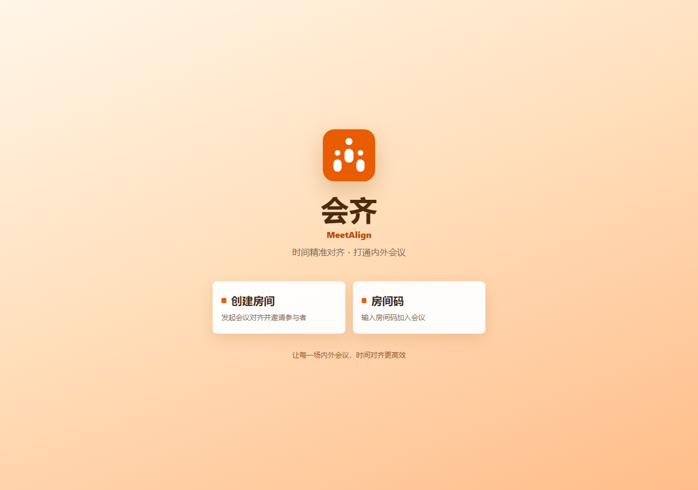
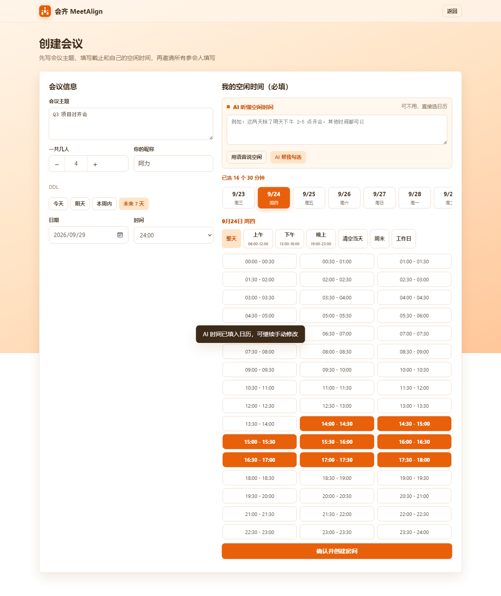
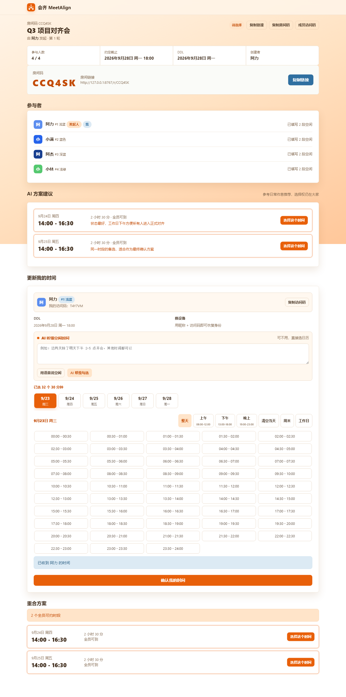
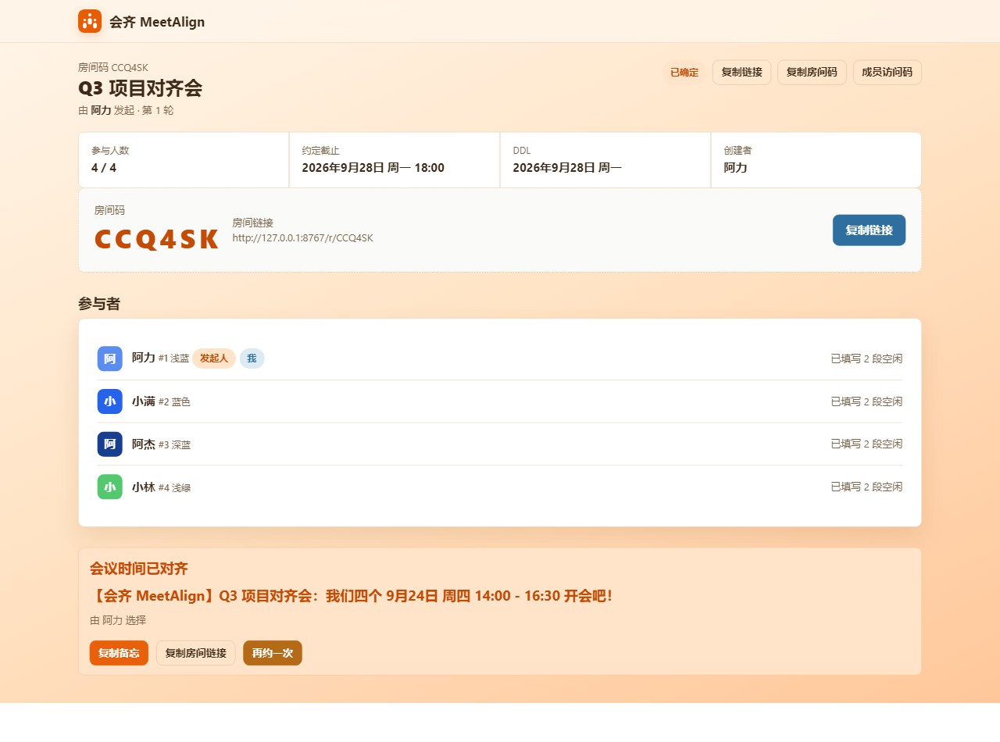

# 会齐 MeetAlign

> 无论企业内外，只要是会议，都可以对齐。

[](https://meetalign-production.up.railway.app)

无需安装，直接打开在线版本即可创建会议、邀请参会人填写时间并完成会议对齐：

**<https://meetalign-production.up.railway.app>**

MeetAlign 直译是“会议对齐”，面向企业会议时间协同：无论是公司内部跨部门会议，还是与客户、供应商、合作伙伴的跨组织会议，都可以先让所有参会人填写可用时间，再由系统完成对齐。

## 界面预览

| 首页 | 创建会议 + AI 语音/文字填时间 |
| --- | --- |
|  |  |
| AI 会议方案建议 | 最终会议时间对齐 |
|  |  |

## 核心能力

- **企业会议场景**：适用于项目对齐、客户评审、供应商沟通、跨部门周会等需要多人共同确认时间的会议。
- **语音/文字填时间**：参会人可以用一句话说“周三下午有会，其他时间都可以”，AI 自动解析成 30 分钟粒度的可用时段，确认后再填入日历。
- **保留手动兜底**：不习惯使用 AI 的成员仍然可以直接在日历中勾选空闲时间。
- **自动计算共同时间**：所有人都填写后，自动列出可用的共同时间段。
- **没有共同空档也能推进**：优先给出最多人参会的候选时间，明确差谁、谁需要调整，并在排除备选后继续推进。
- **AI 会议建议**：结合常规工作作息，推荐 1-2 个更适合开会的方案，深夜和凌晨排在最后。
- **成员身份与权限**：每位参会人有独立编号、颜色和访问码，换设备后也能恢复身份，避免同名误操作。

## 在线体验

<https://meetalign-production.up.railway.app>

线上版本已经部署在 Railway，可直接通过会议链接邀请企业内外参会人。

## 本地运行（仅开发）

下面的 `127.0.0.1` 地址只在本地开发时使用，不是线上访问地址。

```bash
python server.py
```

启动后访问 http://127.0.0.1:8765 。

如需换端口或调整数据目录：

```bash
PORT=9000 python server.py
DATA_DIR=/var/data python server.py
```

## 可选 AI 配置

未配置 AI 时，手动日历、重合计算和协调流程仍可正常使用。需要语音/文字解析和 AI 会议建议时，配置：

```text
LLM_API_KEY=你的模型平台API Key
LLM_BASE_URL=https://api.deepseek.com/v1
LLM_MODEL=deepseek-v4-flash
```

## 技术栈

- 前端：原生 HTML / CSS / JavaScript
- 后端：Python `http.server` + `ThreadingHTTPServer`
- 数据：JSON 文件存储
- 部署：支持 Railway / Render 等 Python 平台

## License

MIT
